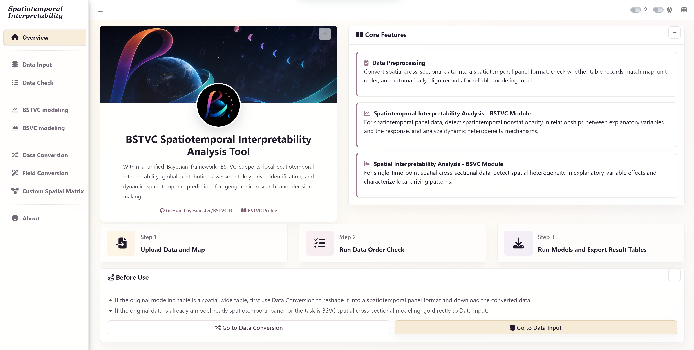

<div align="center">


# [BSTVC Desktop](https://bayesianstvc.github.io/BSTVC-Desktop/)

### Bayesian spatiotemporal interpretability—without a coding-first workflow

**A visual research environment for local spatiotemporal interpretability, global contribution, and dynamic prediction within a unified Bayesian full-map framework.**

[](https://github.com/bayesianstvc/BSTVC-Desktop/releases/tag/v2026.10.25)
[](https://github.com/bayesianstvc/BSTVC-Desktop/releases/tag/v2026.10.25)
[](https://bayesianstvc.github.io/BSTVC-Desktop)

[](https://github.com/bayesianstvc/BSTVC-Desktop/releases/download/v2026.10.25/BSTVC_desktop_EN_win_x64_26.10.25_setup.exe)

**BSTVC Desktop V2 is available.** Package version **26.10.25**, published **4 November 2026**.

[What is new in V2](https://bayesianstvc.github.io/BSTVC-Desktop/v2/) · [中文 V2 更新与讲解视频](https://bayesianstvc.github.io/BSTVC-Desktop/zh/v2/)

**V2’s headline case-study result: narrower reported credible intervals.** Across three public cases, summaries of 95% credible-interval widths were approximately **94%–99% narrower for temporal coefficients** and **38%–98% narrower for spatial coefficients** than in V1. [Explore the V2 comparison](https://bayesianstvc.github.io/BSTVC-Desktop/v2/) · [Watch the English overview](https://bayesianstvc.github.io/BSTVC-Desktop/v2/#video).

If tomorrow’s forecast is 2–30°C, it’s hard to know what to wear. A range of 29–30°C tells you to dress for heat. BSTVC V2 reported narrower ranges for temporal and spatial coefficients across the three cases. The percentages summarize the median interval-width change in each case.

**[Desktop official website](https://bayesianstvc.github.io/BSTVC-Desktop/)** · **[桌面端中文官网](https://bayesianstvc.github.io/BSTVC-Desktop/zh/)** · **[BSTVC brand website](https://bayesianstvc.github.io/)**

</div>

---

<p align="center">
  
</p>

<p align="center"><em>The official English desktop interface: prepare data, verify spatial order, fit BSTVC/BSVC models, and export interpretable results in one guided environment.</em></p>

## Download and official resources

| Resource | Recommended for | Access |
|:--|:--|:--|
| **BSTVC Desktop — English installer** | Windows 10/11 users who want the complete English graphical workflow | **[Download English V2 installer](https://github.com/bayesianstvc/BSTVC-Desktop/releases/download/v2026.10.25/BSTVC_desktop_EN_win_x64_26.10.25_setup.exe)** |
| **English V2 — 26.10.25** | Installer, checksums, and release notes | [Open the GitHub Release](https://github.com/bayesianstvc/BSTVC-Desktop/releases/tag/v2026.10.25) |
| **English online user guide** | Complete workflows for continuous, binary, and count responses; figures, search, and troubleshooting | [Open the English guide](https://bayesianstvc.github.io/BSTVC-Desktop/guide/) |
| **Six case studies and R visualization** | Datasets, maps, result tables, publication figures and plotting scripts | [Choose a case](https://bayesianstvc.github.io/BSTVC-Desktop/guide/#choose) · [GitHub downloads](https://github.com/bayesianstvc/BSTVC-Desktop/releases/tag/guides-cases-v2-2026.11.08) |
| **English official website** | Product overview, methods, workflow, outputs, and download guidance | [bayesianstvc.github.io/BSTVC-Desktop](https://bayesianstvc.github.io/BSTVC-Desktop) |
| **中文官方网站** | 中文方法介绍、案例、下载与使用支持 | [bayesianstvc.github.io/BSTVC-Desktop/zh/](https://bayesianstvc.github.io/BSTVC-Desktop/zh/) |
| **中文桌面版 V2（26.10.25）** | 中文 Windows 安装包与实例数据；操作说明请阅读在线用户手册 | [百度网盘](https://pan.baidu.com/s/5h7zSPjXEvBINShxLVLjirA) |
| **中文在线用户手册** | 中文操作流程、参数说明、结果解读与 V2 说明 | [打开在线用户手册](https://bayesianstvc.github.io/BSTVC-Desktop/zh/assets/bstvc-user-guide.html) · [快速开始](https://bayesianstvc.github.io/BSTVC-Desktop/zh/assets/bstvc-user-guide.html#quick) · [V1/V2 比较](https://bayesianstvc.github.io/BSTVC-Desktop/zh/assets/bstvc-user-guide.html#v2news) |

> **Get started:** Download V2, follow the [English guide](https://bayesianstvc.github.io/BSTVC-Desktop/guide/), or explore the [V2 update](https://bayesianstvc.github.io/BSTVC-Desktop/v2/). The current six-case downloads include English and Chinese guides and R visualization.

**SHA-256 (English installer):** `63c7873b351037de85282ac7da0febbdc6363d3579f4f39bf68b4eeca31ff0b7` · 547,613,237 bytes.

## Six cases, user guides and publication figures

The current English and Chinese guides cover six cases. The fourth case includes separate binary and count walkthroughs. Each case bundle includes inputs, maps, reference result tables, publication figures and the accompanying R visualization scripts.

**English:** [Six cases and figures](https://github.com/bayesianstvc/BSTVC-Desktop/releases/download/guides-cases-v2-2026.11.08/BSTVC-V2-EN-User-Guide-and-Cases.zip) · [R visualization code](https://github.com/bayesianstvc/BSTVC-Desktop/releases/download/guides-cases-v2-2026.11.08/BSTVC-V2-EN-R-Visualization.zip) · [Offline user guide](https://github.com/bayesianstvc/BSTVC-Desktop/releases/download/guides-cases-v2-2026.11.08/BSTVC-Desktop-V2-User-Guide-EN.html)

**中文：** [六个案例与论文图件](https://github.com/bayesianstvc/BSTVC-Desktop/releases/download/guides-cases-v2-2026.11.08/BSTVC-V2-ZH-User-Guide-and-Cases.zip) · [R 制图源码](https://github.com/bayesianstvc/BSTVC-Desktop/releases/download/guides-cases-v2-2026.11.08/BSTVC-V2-ZH-R-Visualization.zip) · [离线用户手册](https://github.com/bayesianstvc/BSTVC-Desktop/releases/download/guides-cases-v2-2026.11.08/BSTVC-Desktop-V2-User-Guide-ZH.html)

| Case | Workflow | Example | Guide |
|:--|:--|:--|:--|
| 1 | Continuous | African under-five mortality | [English walkthrough](https://bayesianstvc.github.io/BSTVC-Desktop/guide/#case1) · [中文操作步骤](https://bayesianstvc.github.io/BSTVC-Desktop/zh/assets/bstvc-user-guide.html#case1) |
| 2 | Binary | COVID-19 in China | [English walkthrough](https://bayesianstvc.github.io/BSTVC-Desktop/guide/#case2) · [中文操作步骤](https://bayesianstvc.github.io/BSTVC-Desktop/zh/assets/bstvc-user-guide.html#case2) |
| 3 | Count | Hepatitis B in the United States | [English walkthrough](https://bayesianstvc.github.io/BSTVC-Desktop/guide/#case3) · [中文操作步骤](https://bayesianstvc.github.io/BSTVC-Desktop/zh/assets/bstvc-user-guide.html#case3) |
| 4 | Binary and count | US suicide | [English walkthrough](https://bayesianstvc.github.io/BSTVC-Desktop/guide/#case4) · [中文操作步骤](https://bayesianstvc.github.io/BSTVC-Desktop/zh/assets/bstvc-user-guide.html#case4) |
| 5 | Spatial | US suicide, 2016 | [English walkthrough](https://bayesianstvc.github.io/BSTVC-Desktop/guide/#case5) · [中文操作步骤](https://bayesianstvc.github.io/BSTVC-Desktop/zh/assets/bstvc-user-guide.html#case5) |
| 6 | Continuous | Global health-adjusted life expectancy | [English walkthrough](https://bayesianstvc.github.io/BSTVC-Desktop/guide/#case6) · [中文操作步骤](https://bayesianstvc.github.io/BSTVC-Desktop/zh/assets/bstvc-user-guide.html#case6) |

[GitHub guide and case release with checksums](https://github.com/bayesianstvc/BSTVC-Desktop/releases/tag/guides-cases-v2-2026.11.08)

## Why BSTVC Desktop?

Many research questions require more than a single average regression coefficient:

> **Why does the same factor have different effects across locations and periods?**

BSTVC Desktop provides an **ante-hoc interpretable Bayesian workflow**. Interpretation is built into model parameters rather than added after fitting an opaque prediction model. Researchers can examine where and when associations vary, identify globally important drivers, retain posterior uncertainty, and connect mechanism-oriented inference with dynamic prediction.

- **Visual and guided:** complete standard analyses without writing an R script.
- **Scientifically transparent:** inspect coefficients, credible intervals, variance contribution, model diagnostics, and predictive outputs.
- **Spatially explicit:** validate map-unit order and construct or import spatial structures before modeling.
- **Research-ready:** export tables and figures for reproducible checking, mapping, and reporting.
- **Local-first:** modeling and data processing run on the user's computer.

## Three research tasks in one full-map framework

<p align="center">
  
</p>

| Research task | Core question | Main model/output |
|:--|:--|:--|
| **Local spatiotemporal interpretability** | Where, when, and how does an explanatory variable affect the outcome? | STVC/STIVC; spatial coefficients (SCs), temporal coefficients (TCs), and posterior credible intervals |
| **Global spatiotemporal interpretability** | Which candidate factors contribute most to overall spatiotemporal variation? | STVPI and explainable-percentage assessment |
| **Dynamic prediction** | How may the outcome change as spatiotemporal conditions evolve? | Smoothing, missing-value imputation, and forecasting |

## Supported response types

Choose the response family according to the distribution of the outcome—not researcher preference.

| Response | Desktop workflow | Typical research outcome |
|:--|:--|:--|
| **Continuous** | Log-Gaussian regression | Rates, indices, measurements, or appropriately transformed continuous outcomes |
| **Binary** | Logistic regression | Event occurrence, status, presence/absence, or two-category outcomes |
| **Count** | Poisson regression | Non-negative event counts observed by spatial unit and time |

## From data to evidence

```text
Spatial map + panel data
          ↓
Data preprocessing and order validation
          ↓
Model selection, priors, and computing parameters
          ↓
Run a Bayesian model and export results
          ↓
SCs / TCs / STVPI / prediction / model evaluation
          ↓
Maps, tables, uncertainty-aware conclusions, and reproducible reporting
```

### Core desktop modules

1. **Overview** — product orientation, core features, and the recommended three-step workflow.
2. **Data Input** — import the map and spatiotemporal panel data.
3. **Data Check** — verify fields, missingness, map-unit identity, and record order.
4. **BSTVC modeling** — estimate spatiotemporally varying relationships for panel data.
5. **BSVC modeling** — analyze spatially varying relationships for cross-sectional data.
6. **Data Conversion** — reshape spatial wide tables into model-ready panel form.
7. **Field Conversion** — prepare and standardize modeling fields.
8. **Custom Spatial Matrix** — construct or import a spatial neighborhood matrix.

## Read the outputs

BSTVC Desktop organizes model output around a transparent evidence chain:

- **Local effects:** spatial coefficients (SCs) and temporal coefficients (TCs).
- **Uncertainty:** Bayesian credible intervals (CrIs), which should not be reduced to a conventional significance-test label.
- **Global contribution:** STVPI and factor-specific explainable percentages.
- **Prediction:** fitted values, smoothing, missing-value estimates, and future projections.
- **Model evaluation:** DIC and WAIC for fit/complexity balance, effective parameters (`pD`), and logarithmic score (`LS`) for predictive accuracy.

## Quick start

1. **Download V2.** Get the English Windows installer, verify the version and SHA-256 listed above, and follow the English online guide to install the app and run a case study.
2. **Prepare** a spatial map and model-ready spatiotemporal panel table.
3. **Validate** map-unit identifiers and observation order in **Data Check**.
4. **Start with STVC** for a first local spatiotemporal analysis, then extend to STIVC or STVPI when the research question requires interaction or global contribution.
5. **Read estimates with uncertainty** and compare candidate models using multiple evaluation criteria.
6. **Export** result tables for mapping, interpretation, and reproducible reporting.

For complete English instructions, follow the **[online BSTVC Desktop User Guide](https://bayesianstvc.github.io/BSTVC-Desktop/guide/)**. The [Chinese guide](https://bayesianstvc.github.io/BSTVC-Desktop/zh/assets/bstvc-user-guide.html) remains available for Chinese-language readers.

## Desktop or R package?

| Choose | Best when you need |
|:--|:--|
| **BSTVC Desktop** | A graphical, guided workflow; lower setup cost; teaching; applied analysis; rapid inspection and export |
| **[BSTVC-R](https://github.com/bayesianstvc/BSTVC-R)** | Earlier V1 research prototype, available for reproducing published R workflows. [Get Desktop V2](https://bayesianstvc.github.io/BSTVC-Desktop/) for the latest release. |

Both interfaces belong to the same BSTVC research ecosystem. The desktop edition is the recommended entry point for most new users; the R package remains available for programmable workflows.

## Companion performance monitor

[BSTVC Process Monitor](https://github.com/bayesianstvc/BSTVC-Monitor) helps Windows users observe CPU and memory use during model fitting and compare thread settings. Start from the desktop default of **6 threads**, then adjust only after monitoring a comparable model run; more threads do not always produce a faster or more stable fit.

## Scientific scope

BSTVC is designed for spatiotemporal panel and areal research in GIScience, spatial statistics, public health, health and medical geography, environmental health, health services research, and broader natural–social science applications. Appropriate model specification, data quality assessment, sensitivity analysis, and domain interpretation remain the responsibility of the researcher.

## Project status and support

- **Status:** actively developed and maintained.
- **Official feedback email:** [bstvc.research@gmail.com](mailto:bstvc.research@gmail.com) for method, desktop, and R package questions. See the [Chinese feedback checklist](https://bayesianstvc.github.io/BSTVC-Desktop/zh/assets/bstvc-user-guide.html#feedback) for reproducible reports.
- **Bug reports and feature requests:** [BSTVC-Desktop Issues](https://github.com/bayesianstvc/BSTVC-Desktop/issues)
- **Statistical framework:** [BSTVC brand website](https://bayesianstvc.github.io/)
- **R package (V1 research prototype):** [bayesianstvc/BSTVC-R](https://github.com/bayesianstvc/BSTVC-R)
- **Desktop development:** [Xianteng Tang](https://tangxxxxt.github.io/)
- **Project leadership and statistical methodology:** [Chao Song](https://chaosong.blog/)

We welcome reproducible bug reports, feature proposals, documentation improvements, code contributions, and new empirical applications.

## Methodological references

1. Song, C., Shi, X., & Wang, J. (2020). Spatiotemporally varying coefficients (STVC) model: a Bayesian local regression to detect spatial and temporal nonstationarity in variable relationships. *Annals of GIS, 26*(3), 277–291.
2. Song, C., Yin, H., Shi, X., et al. (2022). Spatiotemporal disparities in regional public risk perception of COVID-19 using Bayesian spatiotemporally varying coefficients (STVC) series models across Chinese cities. *International Journal of Disaster Risk Reduction, 77*, 103078.
3. Wan, Q., Tang, Z., Pan, J., et al. (2022). Spatiotemporal heterogeneity in associations of national population ageing with socioeconomic and environmental factors at the global scale. *Journal of Cleaner Production, 373*, 133781.
4. Song, C., Shi, X., Bo, Y., Wang, J., Wang, Y., & Huang, D. (2019). Exploring spatiotemporal nonstationary effects of climate factors on hand, foot, and mouth disease using a Bayesian spatiotemporally varying coefficients (STVC) model in Sichuan, China. *Science of the Total Environment, 648*, 550–560.

For an extended publication and application record, visit the **[BSTVC brand website](https://bayesianstvc.github.io/)**.

---

<div align="center">

**BSTVC Desktop — turning spatiotemporal heterogeneity into interpretable Bayesian evidence.**

HEOA–West China Health & Medical Geography Group

[Desktop official website](https://bayesianstvc.github.io/BSTVC-Desktop/) · [桌面端中文官网](https://bayesianstvc.github.io/BSTVC-Desktop/zh/) · [Download](https://github.com/bayesianstvc/BSTVC-Desktop/releases/tag/v2026.10.25) · [English user guide](https://bayesianstvc.github.io/BSTVC-Desktop/guide/) · [中文用户指南](https://bayesianstvc.github.io/BSTVC-Desktop/zh/assets/bstvc-user-guide.html) · **[BSTVC brand website](https://bayesianstvc.github.io/)**

</div>
